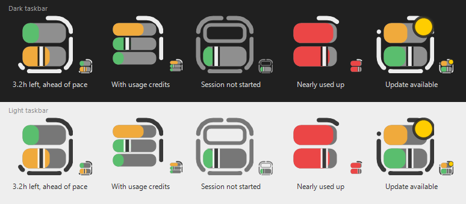
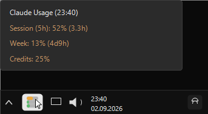
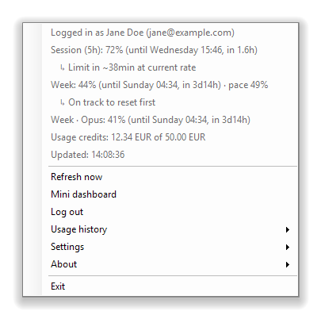
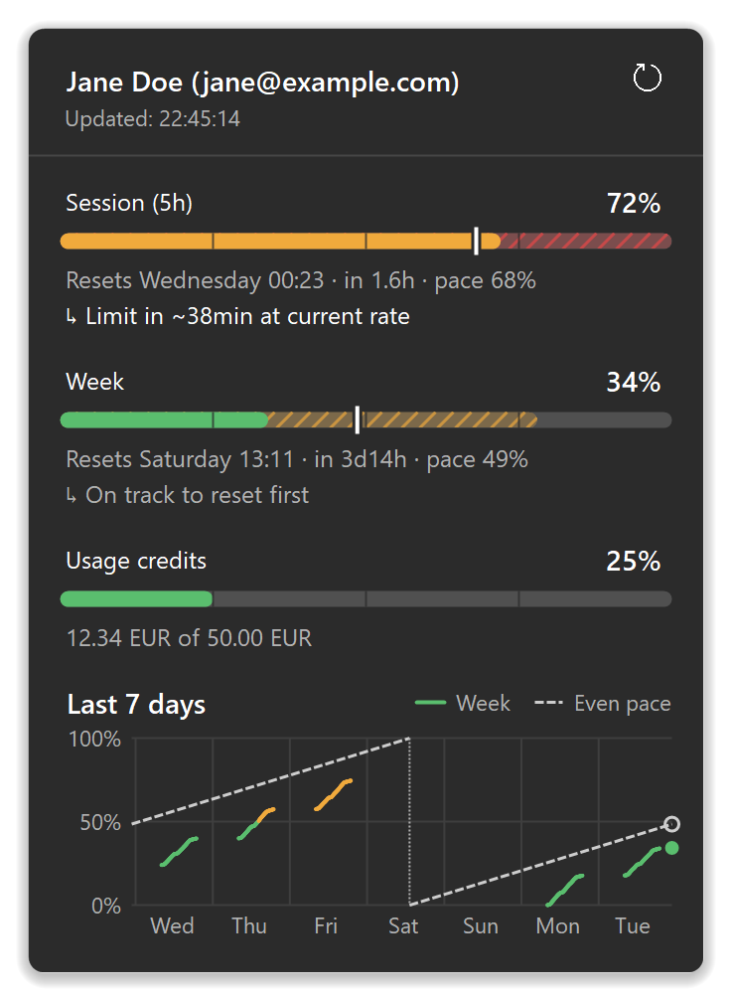
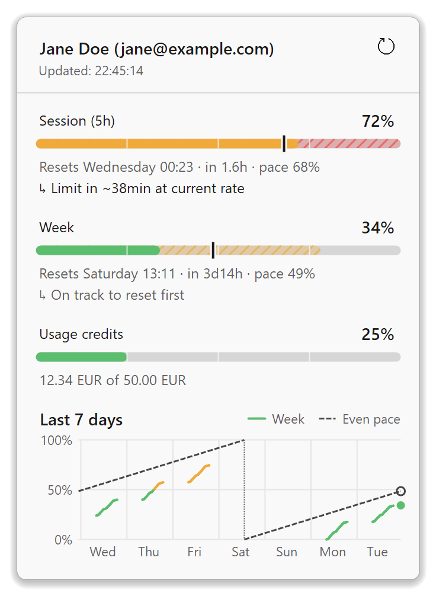
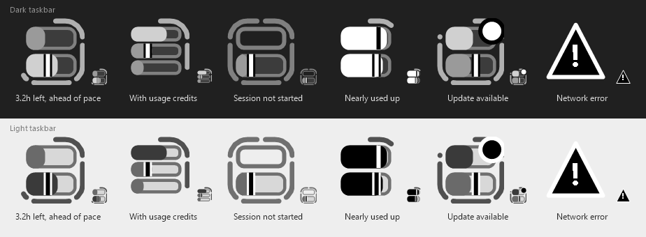
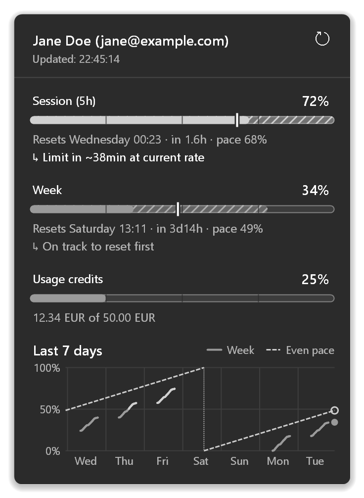
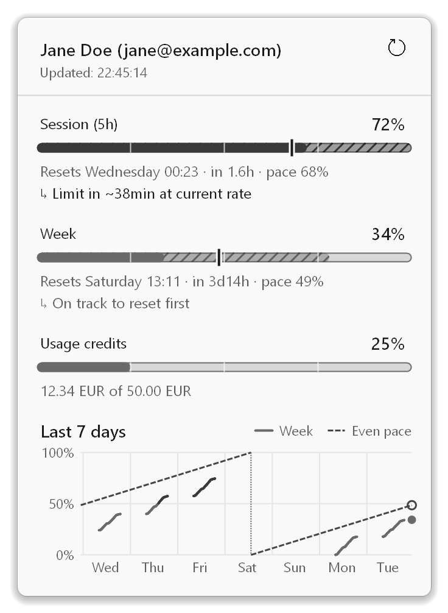
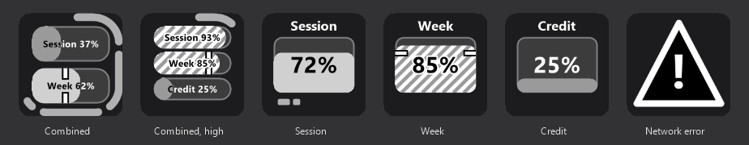

# AI Quota

A small Windows system tray app that shows how much of your Claude.ai Pro/Max plan
limits you've used — at a glance, without opening the Claude Desktop app.


~~[Get it from the Microsoft Store](https://apps.microsoft.com/detail/9NK00NML9J4F)~~

## What it does

The tray icon shows two or three stacked bars:

- **Top bar** — your current 5-hour session usage
- **Middle bar** — your current 7-day (weekly) usage
- **Bottom bar** — your usage credit balance, shown only when your plan reports one



The icon also shows the [session countdown ring](#session-countdown-ring) around the bars,
the [weekly pace marker](#weekly-pace-marker) on the week bar, and a yellow dot when a new
version is available.

Each bar is colour-coded (green ≤ 50%, yellow 50–80%, red > 80%) so you can tell your
usage level without reading a number (or, in [accessibility mode](#accessibility), by
brightness and shape instead of colour). Hover over the icon for exact percentages plus
the time remaining until each window resets (e.g. `Session (5h): 37% (1.5h)`,
`Week: 82% (2d3h)`, `Credits: 25%`):



Right-click for the full menu: signed-in account, exact percentages with reset day/time,
a burn-rate forecast, usage credit balance (used/limit, when available), manual refresh,
login/logout, usage history export/clear, run-at-startup toggle, a session countdown ring
toggle, a weekly pace marker toggle, an accessibility mode toggle, a Stream Dock controller toggle, a
check-for-new-version toggle, and a language switch (German/English):



### Tray flyout

Left-click the icon for a flyout next to the taskbar, like the Windows volume and network
flyouts. It shows:

- your account, when the data was last updated, and a refresh button
- the session, week and (when your plan has them) credit usage as large bars with scale
  ticks at 25%, 50% and 75%, and the reset time as both clock time and countdown
  (`Resets 14:30 · in 1.6h`)
- a [pace marker](#weekly-pace-marker) on the week bar, and one on the session bar for an
  even spread over the 5 hours (`Resets 14:30 · in 1.6h · pace 68%`; not shown before a
  session starts)
- the [burn-rate forecast](#usage-history-and-forecast) under the session and week bars,
  and as a dimmed, hatched extension of each bar up to the usage you'd reach by the reset
  at your current rate
- a chart of your weekly usage over the **last 7 days**

<p>
  
  
</p>

In the chart:

- **Usage**: drawn as a line coloured like the bars, with gaps where the app wasn't
  running.
- **Even pace**: the dashed line, from 0% at the start of each weekly window to 100% at
  its reset. The 7 days usually span a weekly reset, which is marked by a dotted line;
  usage and pace both start again from 0 there.
- **Now**: the dot at the right edge is your current usage, the ring is the current pace.
- **Hover**: shows the time and value of the nearest data point.
- **Not enough history yet**: the chart says it's still collecting data.

Click the icon again, press `Esc`, or click anywhere else to close it. The flyout uses
the data from the last refresh, so it opens instantly; while open, it updates after
every refresh and keeps its countdowns current. It follows the Windows light/dark theme
and your display scaling.

A double-click opens the flyout too (the second click keeps it open). It no longer
refreshes — use the flyout's refresh button or **Refresh now** in the menu.

The app gets this data the same way the official `claude` CLI does: by signing you in
with the same public OAuth client Claude Code uses, then calling the same
`/api/oauth/usage` endpoint. No API key, no scraping, no reading another app's stored
credentials — you log in once via your browser, and the token is encrypted on disk for
your Windows user account only.

If your usage crosses 90% for either window, you'll get a one-time
[notification](#notifications). You'll also get one when, at your current rate, the session
is on track to hit its limit within 30 minutes (see [Usage history and forecast](#usage-history-and-forecast)).

### Notifications

Usage warnings and the new-version notice are Windows notifications with buttons:

| Notification | Example | Buttons |
|---|---|---|
| Session at 90% or more | `Session usage (5h) at 92% · resets 14:30` | **Open usage page**, **Dismiss** |
| Week at 90% or more | `Weekly usage at 90% · resets Mon 09:00` | **Open usage page**, **Dismiss** |
| Session limit forecast | `Session limit (5h) in ~25min at current rate` | **Open usage page**, **Dismiss** |
| New version | `AI Quota v1.5.0 is available` | **Install…**, **Later** |

- **Open usage page** opens [claude.ai/settings/usage](https://claude.ai/settings/usage) in
  your browser. **Install…** opens the same update confirmation as the menu entry.
- Clicking a usage notification itself (not a button) opens the [flyout](#tray-flyout).
- Each kind replaces its previous notification in the notification center instead of
  stacking up, and usage warnings disappear from there once their window resets.
- Windows' notification settings apply: AI Quota is listed under **Settings → System →
  Notifications**, where you can turn it off, and with Do Not Disturb on, notifications
  go silently to the notification center.
- If Windows notifications can't be set up, the app falls back to classic tray balloon
  tips. Clicking one does the same as the notification itself; clicking the new-version
  one opens the update confirmation.

For the notification buttons to work, the zip version registers itself with Windows on
its first start (the MSIX/Store version brings this with the package and removes it on
uninstall). That's a few registry entries under `HKCU\Software\Classes` (`AppUserModelId\…`,
`CLSID\{…}`, `AppID\{…}`) and a copy of the app icon under
`%LOCALAPPDATA%\ToastNotificationManagerCompat\Apps\`. Before deleting the zip version, use
**Settings → Remove notification registration and exit…** to remove them. Otherwise they
stay behind; they're harmless, but Windows keeps listing AI Quota in its notification
settings. The next start registers again.

### Session countdown ring

A countdown frame traces the icon's rounded-square edge around the bars, showing how
much of your current 5-hour session is left before it resets:

- It's split into 5 gapped segments, one per hour of the session. Each solid segment is
  a full hour still left, and the segment for the hour currently ticking away shrinks
  gradually — so the number of visible segments alone tells you how many hours remain,
  no hover needed.
- The segments start at the top centre (12 o'clock) and run clockwise. As time passes,
  the ring empties back towards 12 o'clock: the segment just left of the top goes first,
  the one just right of it goes last.
- An hour that has elapsed isn't drawn at all (there's no background track), so a
  session close to resetting shows just a short stub.
- It's white on a dark taskbar and dark grey on a light one, deliberately different from
  the green/yellow/red usage bars so "time left" is never mistaken for "quota used".
- It's redrawn on every refresh (every 5 minutes, see [Usage](#usage)), so it moves in
  5-minute steps rather than continuously.

It can be turned off under **Settings → Show session countdown ring** if you'd rather
keep just the bars.

### Before a session starts

A 5-hour session only starts with your first message after the previous one expired.
Until then, the icon shows that the clock isn't running yet:

- The **session bar** is drawn as an outline only, in the grey of the bars' empty
  background, instead of a filled bar.
- The **countdown ring** is drawn full (all 5 hours are still available) but in that same
  grey instead of white/dark grey.
- The tooltip and the right-click menu show `(not started)` after the session
  percentage, e.g. `Session (5h): 0% (not started)`.

Once you send a message, the next refresh switches back to the normal look with the
countdown running. The dimmed session bar also shows when the countdown ring is turned
off.

### Weekly pace marker

A thin vertical tick on the week bar marks where your weekly usage would be by now if you
spread the 7-day quota evenly over the week. For example, 3 days into the week it sits at
about 43%:

- **Fill stops before the tick**: you're behind pace, with quota to spare.
- **Fill runs past the tick**: you're ahead of pace and on track to run out before the
  weekly reset.

The tick moves from left to right over the week and starts again at the left after the
reset. It's white on a dark taskbar and dark grey on a light one (like the countdown ring),
with a thin outline in the opposite tone so it stays visible over both the coloured fill and
the empty track. The tooltip and the right-click menu show the same value after the week
percentage, e.g. `Week: 62% (2d3h) · pace 43%`. If the tooltip would get too long (with a
new version available, it can reach Windows' 127-character limit), it leaves out the pace.

It can be turned off under **Settings → Show weekly pace marker**, which also removes the
pace value from the tooltip and the menu, and both pace markers from the
[flyout](#tray-flyout).

### Usage history and forecast

Every successful refresh is saved to a local usage history. The app uses it to forecast
when you'll hit a limit if you keep going at your current rate:

- In the right-click menu, an indented line under the session and week entries shows
  either `↳ Limit in ~40min at current rate` or `↳ On track to reset first`. There's no
  line when there isn't enough recent data yet, when your usage isn't rising, or before a
  session has started.
- In the [flyout](#tray-flyout), the same line sits under the session and week bars, and
  each bar gets a dimmed, hatched extension up to the usage you'd reach by the reset (up to
  100% when the limit comes first), coloured for the level it would reach.
- The tooltip adds ` · limit ~40min` to the session or week line when the limit is forecast
  to come before the reset. If the tooltip would get too long, it leaves out the pace value
  first and then the forecast.
- When the session is forecast to hit its limit within 30 minutes, you get a one-time
  notification. You only get another one after the forecast has gone back above 45 minutes
  (or away).

How the rate is worked out:

- **Session**: from the last 30 minutes, with at least 3 refreshes spanning at least 10
  minutes. A gap of more than 15 minutes (PC asleep, app closed) starts over, so only
  recent, unbroken usage counts.
- **Week**: from the last 24 hours, with at least 6 hours of data, so one heavy session
  isn't extrapolated over the whole week. Gaps don't start over here: weekly usage only
  goes up within a week, so the average across a night is still correct, and it includes
  what you used on other devices in the meantime.
- Only data from the current window counts. After a reset, the forecast starts from
  scratch.

The history stays on your PC. Nothing is sent anywhere.

- **Location**: `%LOCALAPPDATA%\AIQuota\history\`. Each signed-in account has its own file,
  named by a hash of the account ID, so accounts never mix.
- **Format**: one JSON object per line, with the time, session and week usage, their reset
  times, and the credit balance (when your plan reports one).
- **Retention**: entries older than 35 days are deleted automatically.
- Logging out keeps the history. **Usage history → Clear history…** deletes it for all
  accounts.
- **Usage history → Export as CSV…** saves the signed-in account's history as a CSV file.
  It uses the list and decimal separators from your Windows region settings, so it opens
  as proper columns in Excel on German and English systems alike.

### Accessibility

**Settings → Accessibility mode (high-contrast greyscale)** replaces the green/yellow/red
colours with a black, white and grey palette for people with achromatopsia (complete colour
blindness) or anyone who finds the colours hard to tell apart. No information is shown by
colour alone:

- **Usage level by brightness**: the higher the usage, the more the fill stands out from
  the bar's background - mid grey up to 50%, light grey up to 80%, white above (on a light
  taskbar the other way round: mid grey, dark grey, black).
- **Above 80% also by shape**: a notch just before the end of the fill on the tray icon and
  in the flyout, and diagonal hatching on the Stream Dock keys.
- **Bar background**: dark (or light) grey with a thin outline, so the bar's full length
  stays visible against the taskbar without adding large bright areas.
- **Countdown ring**: a mid grey that differs from the brightest fill, so a nearly full
  bar and the ring don't merge.
- **Warning icon and update dot**: black and white with an outline, readable on both a
  light and a dark taskbar.
- **Stream Dock keys**: keep their dark background. The text inside a bar changes colour
  where it crosses the fill edge, so it stays readable on both parts.

The setting is off by default, saved across restarts, and applies immediately to the tray
icon, the flyout and the Stream Dock keys. It's also on automatically while a Windows
contrast theme is active (the menu entry then shows it as checked and can't be turned
off). The tooltip and the menu don't change: they already show the exact percentages.



<p>
  
  
</p>



Contrast (WCAG 2.1): every fill has at least 3.7:1 against the bar background, the bar
outline at least 3.5:1 against the taskbar or flyout background, and text on the Stream
Dock keys at least 7.4:1.

## Installation

**Microsoft Store** (not yet available)
~~(recommended — handles installs and updates automatically):~~

~~- [Install via Microsoft Store Website](https://apps.microsoft.com/detail/9NK00NML9J4F)~~
~~- Install via Microsoft Store App: `ms-windows-store://pdp/?productid=9NK00NML9J4F`~~

Or, install manually from a GitHub Release — each release comes in two variants, pick one:

- **`AIQuota-<version>-win-x64.zip`** (self-contained) — no installer, no .NET
  runtime to install separately. Larger download, but works out of the box.
- **`AIQuota-<version>-win-x64-framework-dependent.zip`** (framework-dependent)
  — much smaller download, but requires the
  [.NET 9 Desktop Runtime](https://dotnet.microsoft.com/download/dotnet/9.0) to already
  be installed.

For the manual zip route, **Windows Defender currently notifies about an unknown
publisher** — the Microsoft Store version above doesn't have this problem.

Then:

1. Download your chosen zip from the
   [Releases](https://github.com/bluepoke/ClaudeUsage/releases) page.
2. Unzip it anywhere (e.g. `C:\Tools\AIQuota`).
3. Run `AIQuota.exe`.

The app has no visible window; look for its icon in the system tray (you may need to
click the "show hidden icons" `^` arrow the first time).

## Usage

1. On first run, the icon shows a grey `?` — you're not logged in yet.
2. Right-click the icon → **Log in with claude.ai…**. Your browser opens; approve the
   sign-in there.
3. The icon updates with your live usage bars. Right-click any time for exact numbers,
   or hover for a quick summary.
4. Optionally check **Run at Windows startup** so it's always there after a reboot.
5. The session countdown ring (**Show session countdown ring**) is on by default;
   uncheck it if you'd rather see just the plain usage bars.
6. The weekly pace marker (**Show weekly pace marker**) is on by default too; uncheck it
   to hide the tick on the week bar and the pace value in the tooltip and menu.
7. Switch the display language under **Language** (German/English) — it defaults to
   your Windows UI language and remembers your choice.

The app polls for updated usage every 5 minutes while it's running (plus whenever you
hit the refresh button in the [flyout](#tray-flyout) or **Refresh now** in the menu), and
refreshes its access token automatically in the background.

**Automatically check for new version** (on by default) periodically checks GitHub
Releases for a newer version. When one is found, you'll get a one-time
[notification](#notifications) and a new menu entry (e.g. `New version available: v1.2.0`).
Click **Install…** in the notification or the menu entry, and confirm the prompt to
download, install, and restart with the new version —
nothing happens without that confirmation. It picks the same self-contained/framework-
dependent variant you're already running, matching Defender's usual "unknown publisher"
warning for the manual zip route.

## Stream Dock controller support

Enable **Show on Stream Dock controller** from the right-click menu and a key on any
Stream Dock-protocol device (Soomfon "Stream Controller", Ajazz, Mirabox, ... - the same
hardware/software family under different brands) can mirror the same usage bars and
countdown ring (including the dimmed look before a session starts), and trigger a
refresh on press. Each key can instead show a single value - the 5-hour session (with
an hour-by-hour countdown underneath), the week, or the usage credits - as one large
bar, so you can spread them over several keys. A key can also flash once its value
reaches a threshold you set (90% by default); hold the key to stop it. This needs a small companion plugin
installed in the controller's host app - see [`streamdock-plugin/README.md`](streamdock-plugin/README.md)
for how it works and how to install it.

## Building from source

Requires the [.NET 9 SDK](https://dotnet.microsoft.com/download) and Windows.

```
git clone https://github.com/bluepoke/ClaudeUsage.git
cd ClaudeUsage
dotnet build
```

To produce a single-file release build like the ones in GitHub Releases:

```
# self-contained (no .NET runtime required on the target machine)
dotnet publish AIQuota -c Release -r win-x64 --self-contained true -p:PublishSingleFile=true -o publish

# framework-dependent (smaller, requires the .NET 9 Desktop Runtime on the target machine)
dotnet publish AIQuota -c Release -r win-x64 --self-contained false -p:PublishSingleFile=true -o publish
```

The screenshots in [`screenshots/`](screenshots/) (except the tooltip) are generated from
the app's own rendering code with mock data, so they can be refreshed after UI changes:

```
dotnet run --project tools/Screenshots
```

See [`tools/Screenshots/Program.cs`](tools/Screenshots/Program.cs) for what it renders.

Releases are built automatically by [`.github/workflows/release.yml`](.github/workflows/release.yml)
whenever a tag matching `v*.*.*` is pushed.

### MSIX package (Microsoft Store submission)

The same workflow also builds an unsigned `.msix` package for submission to the
Microsoft Store, from [`AIQuota/Package/AppxManifest.xml`](AIQuota/Package/AppxManifest.xml)
and the placeholder icons in [`AIQuota/Package/Assets`](AIQuota/Package/Assets/).
It's uploaded as a workflow artifact (not attached to the public GitHub Release), for
manual upload to [Partner Center](https://partner.microsoft.com/dashboard) — the Store
signs the package itself during certification, so no local code-signing certificate is
needed.

The app is registered in Partner Center as `PeterKossek.ClaudeUsageTray`, listed at
[apps.microsoft.com/detail/9NK00NML9J4F](https://apps.microsoft.com/detail/9NK00NML9J4F).
The only thing still worth doing manually: replace the placeholder icons in
`AIQuota/Package/Assets/` with real artwork (same file names/sizes).

## Privacy & security notes

- The app only requests the minimal OAuth scopes needed to read your usage
  (`user:inference user:profile`) — not the full scope set Claude Code itself uses.
- Your access/refresh token is stored encrypted (Windows DPAPI, current user only) in
  `%APPDATA%\AIQuota\`, and nowhere else.
- The app never reads Claude Desktop's or Claude Code's stored credentials — every
  login is a fresh, explicit sign-in you approve in your browser.

## About this project

This is a personal utility, not an official Anthropic product. It was built with the
help of [Claude Code](https://claude.com/claude-code).

## License

[MIT](LICENSE)
